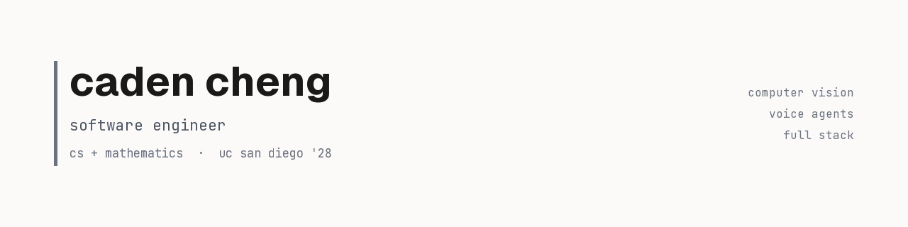

<picture>
  <source media="(prefers-color-scheme: dark)" srcset="assets/banner-dark.png">
  <source media="(prefers-color-scheme: light)" srcset="assets/banner-light.png">
  
</picture>

  <a href="https://www.cadenfcheng.com"><strong>cadenfcheng.com</strong></a> &nbsp;·&nbsp;
  <a href="https://linkedin.com/in/cadenfcheng">linkedin</a> &nbsp;·&nbsp;
  <a href="mailto:cfc005@ucsd.edu">cfc005@ucsd.edu</a>

---

math that ships — applied math and CS turned into systems that actually run. real-time computer vision, voice agents, and full-stack products.

- 🔭 **currently** — VP of Technology @ Computer Science Engineering Society, leading 3 engineers on production RAG features
- 🧪 **previously** — SWE Intern @ Barobo (AWS CloudFront, DynamoDB, Terraform)
- 🎓 **studying** — B.S. Computer Science & Mathematics @ UC San Diego, Data Science minor, '28
- 🏃 **outside of code** — distance running, and the sports science behind training (which is where two of the projects below came from)

## selected projects

| project | what it does | highlight |
| :-- | :-- | :-- |
| **[remark.](https://github.com/cadencheng888/remark.)** | voice agent that turns overheard plans into calendar events and spoken commands into actions | 3.2s median speech-to-event latency, routing across 11 apps · Berkeley AI Hackathon |
| **[inVISION](https://github.com/MICH3LL3D/inVISION)** | turns a phone photo into a 3D model you rotate with your hand | cut renderer peak memory 5× (34.7 → 6.7 MB) · 🏆 **Best Interactive AI, DiamondHacks** |
| **[Silent Speech](https://github.com/davdwan21/Silent-Speech)** | real-time lip reading from mouth and jaw landmarks | BiGRU hitting 78% live word accuracy · 🥇 **#1 Overall Best Hack, SanD Hacks** |
| **[cadence](https://github.com/cadencheng888/cadence)** | in-browser running-form analyzer with skeleton overlay and gait metrics | runs fully client-side via WebAssembly — video never leaves your device |
| **[garmin-mcp](https://github.com/cadencheng888/garmin-mcp)** | MCP server connecting Garmin watch data to Claude | six tools: sleep, heart rate, workouts, stress, steps, daily summaries |
| **[re-scorched](https://github.com/cadencheng888/re-scorched)** | prescribed-fire planning simulator over live satellite imagery | Rothermel fire-spread modeling on real Earth Engine bands, rendered on a 3D globe |

## stack

 

<picture>
  <source media="(prefers-color-scheme: dark)" srcset="https://github-readme-stats.vercel.app/api?username=cadencheng888&show_icons=true&hide_border=true&bg_color=00000000&title_color=9CA3AF&text_color=9CA3AF&icon_color=9CA3AF">
  
</picture>
